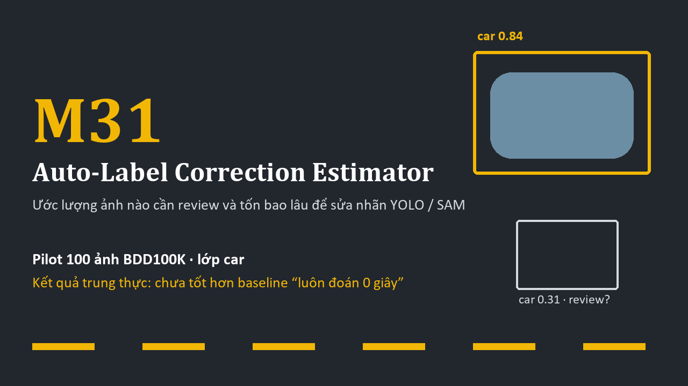

# M31 · Auto-Label Correction Estimator

Ứng dụng Streamlit chạy cục bộ: với mỗi ảnh đã được YOLO (detection) hoặc SAM (segmentation) gán nhãn tự động,
ước lượng **chất lượng pre-label**, **thời gian sửa** và **mức ưu tiên review**, rồi đối chiếu với
**thời gian sửa thật** khi có correction log.


## Nhóm thực hiện và tỷ lệ đóng góp

| Thành viên | Mã học viên | Vai trò | Tỷ lệ đóng góp |
|---|---|---|---|
| Nguyễn Công Thành | 2A202602219 | Trưởng nhóm | 45% |
| Lưu Quang Hùng | 2A202602142 | TV2 | 40,1% |
| Kim Nguyên Khôi | 2A202602116 | TV1 | 4,9% |
| Nguyễn Văn Trọng | 2A202602276 | TV3 | 10% |

Tỷ lệ đóng góp do nhóm cung cấp. Nhật ký công việc theo từng thành viên cần được bổ sung theo các nhiệm vụ và bằng chứng thực tế.
> ## Trạng thái (cập nhật 2026-10-18)
> - Đã tích hợp **pilot thật: 100 ảnh BDD100K, chỉ lớp car**, YOLOv8n + SAM-B (box prompt từ YOLO).
>   Đây là pilot nhỏ, **không** phải đánh giá trên toàn bộ BDD100K.
> - Thời gian sửa vẫn dùng **baseline heuristic tạm thời** (hằng số giả định). Trên pilot, baseline
>   **ước lượng quá cao khoảng 30–40 lần** và **không tốt hơn** việc đoán hằng số; điểm chất lượng hầu như
>   **không tương quan** với thời gian sửa thật. Chi tiết: [docs/01_bai_toan_giai_phap_gioi_han.md](docs/01_bai_toan_giai_phap_gioi_han.md).
> - Mô hình hiệu chỉnh **không được bật** vì mỗi task chỉ có 13 ảnh có thời gian sửa > 0.
> - Đã thử thêm 29 đặc trưng box/mask (cross-validation lặp 50 lần): **không mô hình nào thắng "luôn đoán 0 giây"**,
>   nên chưa dùng chúng để dự đoán. Chi tiết: [docs/07_phan_tich_dac_trung.md](docs/07_phan_tich_dac_trung.md).
> - `data/sample/` là **dữ liệu MINH HỌA sinh ngẫu nhiên**, không phải số đo thật.



Tài liệu trình bày: [slide](docs/M31_slides_team.pptx) · [kịch bản video demo](docs/05_kich_ban_video_demo.md).

## Cài đặt (Windows, PowerShell)

Yêu cầu Python ≥ 3.10 (đã chạy thử với 3.14.2).

```powershell
git clone <URL-repo>
cd M31-AutoLabel-Correction-Estimator
py -m venv .venv
.\.venv\Scripts\Activate.ps1      # nếu bị chặn: Set-ExecutionPolicy -Scope CurrentUser RemoteSigned
pip install -r requirements.txt   # streamlit, pandas, numpy, pillow
```

## Dữ liệu

| Có trong repository | Chỉ ở máy local (bị `.gitignore`) |
|---|---|
| `data/real/processed/`: pre-label, đặc trưng, kết quả phân tích và `pilot100_correction_log.csv` (thời gian sửa/ghi chú). Nhóm đã xác nhận đồng ý công khai log ngày 18/10/2026. | `data/real/local/end_corrected.zip`: gói gốc khoảng 170 MB, gồm overlay và mask sinh từ ảnh BDD100K |
| `data/sample/`: dữ liệu MINH HỌA | — |
| | Mọi `*.zip`, `*.png`, `*.jpg` trong `data/`; `.venv/`; secrets (`.streamlit/secrets.toml`, `.env`) |

**Sau khi clone, app chạy được ngay** với nguồn "Pilot thật" (đọc CSV processed), gồm correction log để đối chiếu ở tab ④. App không có ảnh overlay (cần ZIP); giao diện báo rõ giới hạn này.
Muốn xem overlay hoặc tạo lại dữ liệu processed (máy có gói pilot):

1. Sao chép gói vào `data\real\local\end_corrected.zip`.
2. Chạy (không ghi đè file đã có trừ khi thêm `--overwrite`):
   ```powershell
   .\.venv\Scripts\python.exe scripts\prepare_real_data.py
   .\.venv\Scripts\python.exe scripts\build_features.py
   .\.venv\Scripts\python.exe scripts\analyze_features.py    # vài phút
   ```

Không có dữ liệu pilot thì app vẫn chạy: chọn **Tải lên file thật** hoặc **Dữ liệu MINH HỌA**.

## Chạy ứng dụng

```powershell
.\.venv\Scripts\Activate.ps1
streamlit run app.py
```

Hoặc nhấp đúp `run_app.bat`. Mở `http://localhost:8501`.

## Triển khai lên server

Ứng dụng là một tiến trình Streamlit duy nhất; không cần cơ sở dữ liệu, GPU, model YOLO/SAM hay BDD100K.

**Yêu cầu:** Python ≥ 3.10 (đã chạy thử với 3.14.2 và các phiên bản trong `requirements-lock.txt`), một cổng TCP mở (mặc định 8501).

### Linux (bash)

```bash
git clone <URL-repo> m31 && cd m31
python3 -m venv .venv
. .venv/bin/activate
pip install -r requirements.txt            # hoặc: pip install -r requirements-lock.txt (đúng phiên bản đã thử)
python -m unittest discover tests          # kiểm tra nhanh, phải ra "OK"
chmod +x run_server.sh
./run_server.sh                            # lắng nghe 0.0.0.0:8501
```

`run_server.sh` tương đương với:

```bash
python -m streamlit run app.py --server.address 0.0.0.0 --server.port 8501 \
  --server.headless true --browser.gatherUsageStats false
```

Đổi cổng hoặc địa chỉ: `PORT=8080 ./run_server.sh`, hoặc `ADDRESS=127.0.0.1 ./run_server.sh` khi đặt sau reverse proxy.
Có thể dùng biến môi trường của Streamlit thay cho tham số: `STREAMLIT_SERVER_ADDRESS=0.0.0.0`, `STREAMLIT_SERVER_PORT=8501`.

Chạy nền đơn giản: `nohup ./run_server.sh > m31.log 2>&1 &` (hoặc dùng `tmux`/`systemd`).

### Windows Server (PowerShell)

```powershell
git clone <URL-repo> m31; cd m31
py -m venv .venv
.\.venv\Scripts\Activate.ps1
pip install -r requirements.txt
python -m unittest discover tests
python -m streamlit run app.py --server.address 0.0.0.0 --server.port 8501 --server.headless true --browser.gatherUsageStats false
```

### Kiểm tra sau khi chạy

- Trên server: `curl http://127.0.0.1:8501/_stcore/health` phải trả về `ok`.
- Từ máy khác: mở `http://<IP-server>:8501`. Nếu không vào được, kiểm tra firewall / security group đã mở cổng.

### Lưu ý khi đưa ra ngoài

- **App không có đăng nhập.** Ai có URL đều xem được dữ liệu pilot và tải CSV lên được. Nên giới hạn IP truy cập,
  hoặc đặt sau reverse proxy có xác thực. Nếu dùng nginx, cần bật proxy WebSocket cho `/_stcore/stream`.
- **Dữ liệu trên server:** correction log pilot đã được nhóm đồng ý công khai và nằm trong repository. ZIP, ảnh và mask BDD100K không được đưa lên server công khai.
- Không đặt token hay mật khẩu trong code. Nếu sau này cần, dùng `.streamlit/secrets.toml` hoặc `.env` (đều đã bị `.gitignore`).

Luồng demo trong ứng dụng:
1. **① Chọn dữ liệu**: Pilot thật (local) / Tải lên / Minh họa. Mỗi nguồn có nhãn riêng ở đầu trang.
2. **② Danh sách & ưu tiên review**: bảng toàn bộ ảnh, lọc theo tác vụ/model/ưu tiên, tải CSV kết quả.
3. **③ Chi tiết ảnh & pre-label**: overlay YOLO/SAM (đọc trực tiếp từ ZIP local), đặc trưng đầu vào, ước lượng và log sửa thật.
4. **④ So sánh với thời gian sửa thật**: MAE so với mốc hằng số, tương quan, bảng ưu tiên × ảnh thực sự cần sửa.
5. **⑤ Giới hạn & kiểm tra rò rỉ**: danh sách cột được dùng làm đầu vào và các cột bị cấm.

## Kiểm thử

```powershell
.\.venv\Scripts\python.exe -m unittest discover tests
```

20 test (schema, chống rò rỉ, hiệu chỉnh, script xử lý dữ liệu và đặc trưng trên ZIP tự tạo). Chi tiết: [docs/03_thiet_ke_va_kiem_thu.md](docs/03_thiet_ke_va_kiem_thu.md).

## Cấu trúc

```
app.py                        Giao diện Streamlit (tiếng Việt)
m31/schema.py                 Schema CSV, kiểm tra hợp lệ, chặn cột ground truth / sau-sửa
m31/baseline.py               Baseline heuristic TẠM THỜI (hằng số giả định)
m31/estimator.py              Điểm chất lượng, thời gian, ưu tiên, lý do
m31/calibration.py            Đối chiếu với correction log: MAE, CV, mốc hằng số, bảng ưu tiên  ← chỗ thay mô hình
scripts/prepare_real_data.py  ZIP pilot → CSV đã xử lý + manifest
scripts/build_features.py     ZIP pilot → bảng đặc trưng mở rộng + data dictionary
scripts/analyze_features.py   CV so với các baseline đơn giản, kiểm định hoán vị
scripts/make_sample_data.py   Sinh dữ liệu MINH HỌA
scripts/make_slides.py        Tạo docs/M31_slides_team.pptx (cần python-pptx, không bắt buộc)
scripts/make_thumbnail.py     Tạo docs/thumbnail.png
data/sample/                  Dữ liệu MINH HỌA (ILLUSTRATIVE_*.csv)
data/real/local/              Bản sao ZIP pilot (local, bị .gitignore)
data/real/processed/          CSV pilot đã xử lý (correction log thật bị .gitignore)
run_server.sh                 Chạy Streamlit trên server Linux (0.0.0.0, cổng qua biến PORT)
requirements-lock.txt         Phiên bản thư viện đã chạy thử (pip freeze)
docs/                         Tài liệu nộp, slide (.pptx), thumbnail
tests/test_core.py            Unit test
```

## Dữ liệu vào / ra

**Pre-label CSV** (bắt buộc): `image_id,task,model,mean_confidence,num_predictions,low_confidence_count,image_width,image_height`
Cột tùy chọn: `min_confidence,small_box_count,mean_box_area_ratio,mean_mask_fill_ratio,empty_mask_count,confidence_source`.

**correction_log.csv** (tùy chọn, chỉ để đối chiếu): `image_id,task,model,correction_time_sec,edits_added,edits_removed,edits_changed` (+ `status`, `notes`).

**Đầu ra mỗi ảnh**: `predicted_quality_score` (0–100, thử nghiệm), `estimated_correction_time_sec`, `priority` (thấp/vừa/cao), `reason`.

Ground truth và mọi thông tin chỉ có sau khi con người sửa **không bao giờ** là đầu vào dự đoán.

## Tài liệu

- [Bài toán, giải pháp, kết quả pilot và giới hạn](docs/01_bai_toan_giai_phap_gioi_han.md)
- [Kiến trúc](docs/02_kien_truc.md)
- [Thiết kế và kiểm thử](docs/03_thiet_ke_va_kiem_thu.md)
- [Nhật ký](docs/04_nhat_ky.md)
- [Kịch bản video demo (≤ 3 phút)](docs/05_kich_ban_video_demo.md)
- [Slide M31_slides_team.pptx](docs/M31_slides_team.pptx) và [mô tả từng slide](docs/06_noi_dung_slide.md)
- [Phân tích đặc trưng mở rộng + data dictionary](docs/07_phan_tich_dac_trung.md): 29 đặc trưng box/mask; không mô hình nào thắng "luôn đoán 0 giây", nên chưa tích hợp vào dự đoán
- [Checklist nộp bài](docs/08_checklist_nop_bai.md)
