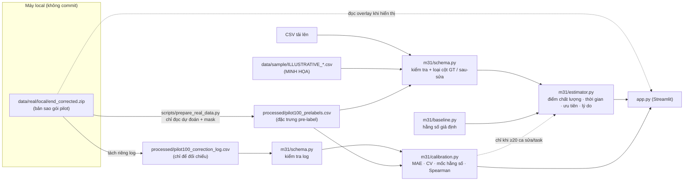

# Kiến trúc

**Ranh giới chống rò rỉ:** đầu vào của `estimator.estimate()` chỉ là bảng pre-label. Correction log chỉ đi vào
`calibration.evaluate()` và `priority_vs_correction()`, tức chỉ dùng để đánh giá. Đường nét đứt từ calibration về
estimator (dùng mô hình đã hiệu chỉnh) bị tắt khi dữ liệu chưa đủ; với pilot hiện tại, nó đang tắt.

## Thành phần

| Module | Trách nhiệm |
|---|---|
| `m31/schema.py` | Hợp đồng dữ liệu; chuẩn hoá `task`; kiểm tra miền giá trị; giữ cột đặc trưng tùy chọn; loại cột GT và cột sau-sửa kèm cảnh báo |
| `m31/baseline.py` | Điểm chất lượng và thời gian sửa theo công thức cố định |
| `m31/estimator.py` | Ghép đầu ra mỗi ảnh; mức ưu tiên theo ngưỡng; lý do bằng tiếng Việt |
| `m31/calibration.py` | Ghép log theo `(image_id, task, model)`; MAE; ridge CV; mốc hằng số; Spearman; bảng ưu tiên × cần sửa; chỗ thay mô hình |
| `scripts/prepare_real_data.py` | ZIP → CSV đã xử lý + manifest (hash, ngưỡng, kiểm tra số dự đoán so với log) |
| `app.py` | Chọn nguồn dữ liệu, gắn nhãn nguồn, 4 tab demo, đọc overlay từ ZIP |

## Thay thế thành phần

- **Dữ liệu mới**: bàn giao CSV đúng schema rồi chọn "Tải lên file thật", hoặc viết script chuyển đổi tương tự `prepare_real_data.py`.
- **Mô hình mới**: lớp có `name`, `is_calibrated`, `predict(df) -> Series`, tạo trong `calibration.evaluate()`.
